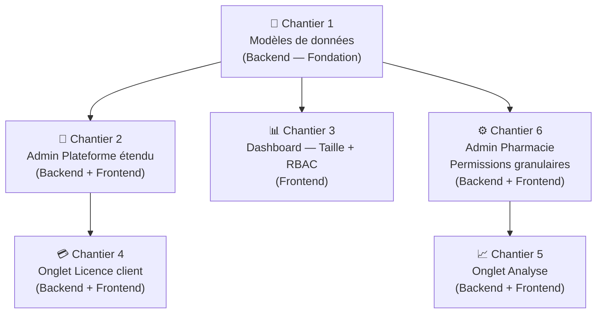
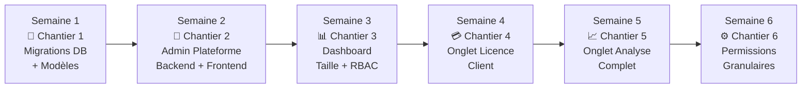

12A# 🗺️ Plan d'Implémentation — PharmaGest Online

> **6 chantiers — priorisés du plus fondamental au plus avancé**  
> Chaque étape s'appuie sur la précédente. Il est conseillé de respecter l'ordre.

---

## 📊 Vue d'Ensemble des Chantiers



---

## 🔧 Chantier 1 — Modèles de Données (Fondation Obligatoire)

> [!IMPORTANT]
> Ce chantier doit être réalisé **en premier**. Tous les autres en dépendent.

### 1.1 — Ajout colonne `enabled_features` sur `pharmacies`

**Fichier :** `backend/app/models/pharmacy.py`

```python
# Nouvelle colonne JSON : liste des fonctionnalités activées pour cette pharmacie
# Exemple : ["pos", "stock", "tiers_payant", "obr", "reports", "analyse"]
enabled_features = Column(JSON, nullable=True, default=None)
```

- **Valeur `null`** → utiliser les features par défaut du plan (`PLAN_FEATURES`)
- **Valeur explicite** → liste personnalisée, cochée par l'Admin Plateforme à la création

### 1.2 — Ajout colonne `allowed_features` sur `users`

**Fichier :** `backend/app/models/user.py`

```python
# Fonctionnalités autorisées pour cet utilisateur précis (sous-ensemble des features pharmacie)
# Exemple : ["pos", "stock"] → ce caissier ne voit que la caisse et le stock
allowed_features = Column(JSON, nullable=True, default=None)
```

- **Valeur `null`** → utiliser les droits complets du rôle
- **Valeur explicite** → restrictions cochées par l'Admin Pharmacie

### 1.3 — Ajout table `platform_admins` (ou extension `users`)

**Option retenue : Extension du modèle `User` existant**

Le rôle `PLATFORM_ADMIN` est déjà dans l'enum `UserRole`. Il faut :

- Permettre plusieurs admins plateforme (`pharmacy_id = null`)
- Ajouter colonne `is_super_platform_admin` pour distinguer l'admin principal (ne peut pas être supprimé)

**Fichier :** `backend/app/models/user.py`

```python
is_super_platform_admin = Column(Boolean, default=False, nullable=False)
```

### 1.4 — Ajout table `license_keys`

**Nouveau fichier :** `backend/app/models/license_key.py`

```python
class LicenseKey(Base, BaseModelMixin):
    __tablename__ = "license_keys"
    key         = Column(String(64), unique=True, nullable=False, index=True)
    plan        = Column(String(30), nullable=False)        # basic / pro / enterprise
    duration_days = Column(Integer, nullable=False)         # 30, 90, 180, 365
    max_users   = Column(Integer, nullable=False, default=3)
    pharmacy_id = Column(Integer, ForeignKey("pharmacies.id"), nullable=True)
    used_at     = Column(DateTime, nullable=True)
    expires_at  = Column(DateTime, nullable=True)           # expiration de la clé elle-même
    created_by  = Column(Integer, ForeignKey("users.id"), nullable=True)
    is_active   = Column(Boolean, default=True, nullable=False)
    notes       = Column(String(300), nullable=True)
```

### 1.5 — Migration Alembic

**Commandes à exécuter :**

```bash
alembic revision --autogenerate -m "add_features_permissions_license_keys"
alembic upgrade head
```

---

## 🔑 Chantier 2 — Admin Plateforme Étendu

### 2.1 — Backend : CRUD des Admins Plateforme

**Nouveau fichier :** `backend/app/routes/platform_admin_users.py`

| Méthode  | Route                   | Description                      |
| -------- | ----------------------- | -------------------------------- |
| `GET`    | `/platform/admins`      | Liste tous les admins plateforme |
| `POST`   | `/platform/admins`      | Crée un nouvel admin plateforme  |
| `PUT`    | `/platform/admins/{id}` | Modifie nom/email/mot de passe   |
| `DELETE` | `/platform/admins/{id}` | Désactive l'admin (soft-delete)  |

> [!CAUTION]
> L'admin principal (`is_super_platform_admin = True`) ne peut **jamais** être supprimé ni dégradé. Guard à ajouter côté backend.

### 2.2 — Backend : Génération de Clés de Licence

**Extension de :** `backend/app/routes/license.py`

| Méthode | Route                                | Description                                       |
| ------- | ------------------------------------ | ------------------------------------------------- |
| `POST`  | `/platform/licenses/generate`        | Génère 1 ou N clés selon plan + durée             |
| `GET`   | `/platform/licenses`                 | Liste toutes les clés (filtrables par plan, état) |
| `PUT`   | `/platform/licenses/{key_id}/revoke` | Révoque une clé non utilisée                      |

**Logique de génération :**

```python
import secrets
def generate_license_key(plan: str, duration_days: int) -> str:
    prefix = {"basic": "BSC", "pro": "PRO", "enterprise": "ENT"}[plan]
    token = secrets.token_hex(16).upper()
    # Format : PRO-XXXXXXXXXXXXXXXX-365
    return f"{prefix}-{token[:8]}-{token[8:16]}-{duration_days}D"
```

### 2.3 — Backend : Création Pharmacie avec Features Cochables

**Extension de :** `backend/app/routes/platform_admin.py`  
→ Endpoint `POST /platform/pharmacies` reçoit maintenant :

```json
{
  "name": "Pharmacie du Centre",
  "plan": "pro",
  "enabled_features": ["pos", "stock", "tiers_payant", "obr", "reports"],
  "max_users": 5
}
```

Si `enabled_features` est omis → valeurs par défaut du plan sont utilisées.

### 2.4 — Frontend : 3 nouveaux onglets dans `platform_admin_page.dart`

**Structure des onglets de la page :**

```
TabBar :
  ▸ [Pharmacies]         (existant)
  ▸ [Admins Plateforme]  (NOUVEAU)
  ▸ [Licences]           (NOUVEAU)
  ▸ [Métriques]          (existant)
```

**Onglet "Admins Plateforme" :**

- Tableau des admins plateforme avec colonnes : Nom, Email, Statut, Date création, Actions
- Bouton `+ Nouvel Admin` → Formulaire Dialog (Nom, Email, Mot de passe temporaire)
- Actions par ligne : Modifier (crayon), Désactiver/Activer (toggle), Supprimer (corbeille — grisée pour l'admin principal)

**Onglet "Licences" (vue Admin Plateforme) :**

- Formulaire de génération :
  - Plan : `basic` / `pro` / `enterprise` (DropdownButton)
  - Durée : 30j / 90j / 180j / 365j (SegmentedButton)
  - Nombre de clés à générer : 1 à 50
  - Bouton `Générer` → liste les clés générées avec bouton copier
- Tableau des clés existantes : Clé, Plan, Durée, Statut (Disponible / Utilisée / Révoquée), Pharmacie liée, Date utilisation

**Dialog Création Pharmacie amélioré :**

- Section `Fonctionnalités incluses` avec checkboxes
- Coché par défaut selon le plan sélectionné
- Admin Plateforme peut décocher ou ajouter manuellement

**Fonctionnalités disponibles (checkboxes) :**

| Clé                   | Label affiché                   |
| --------------------- | ------------------------------- |
| `pos`                 | Point de Vente (caisse)         |
| `stock`               | Gestion des stocks & lots       |
| `tiers_payant`        | Assurances & Tiers-Payant       |
| `obr`                 | Facturation fiscale OBR EBMS    |
| `reports`             | Rapports & Exports              |
| `analyse`             | Tableau de Bord Analyse Avancée |
| `customer_management` | Fichier Patients & Crédits      |
| `cloud_sync`          | Synchronisation Cloud           |
| `audit_logs`          | Journal d'Audit                 |

**Nouveaux fichiers Frontend :**

```
frontend1/lib/screens/admin/
  ├── platform_admin_page.dart   (modifié — ajout onglets)
  ├── tabs/
  │   ├── platform_admins_tab.dart    (NOUVEAU)
  │   └── platform_licenses_tab.dart  (NOUVEAU)
frontend1/lib/services/
  └── platform_admin_service.dart (modifié — ajout méthodes)
frontend1/lib/models/
  └── license_key.dart (NOUVEAU)
```

---

## 📊 Chantier 3 — Dashboard : Taille des Cartes + Contrôle RBAC

### 3.1 — Réduction de la taille des StatsCards

**Fichier :** `frontend1/lib/widgets/dashboard/stats_card.dart`

Modifications :

- `padding: EdgeInsets.all(20)` → `padding: EdgeInsets.symmetric(horizontal: 14, vertical: 10)`
- `headlineMedium` → `titleLarge` (police plus petite)
- Icône container : `padding: EdgeInsets.all(12)` → `EdgeInsets.all(8)`
- `childAspectRatio: 2.5` dans la grille → `3.2` (cartes plus fines)
- `mainAxisSpacing: 24` → `16`, `crossAxisSpacing: 24` → `16`

### 3.2 — Contrôle RBAC des cartes du Dashboard

**Fichier :** `frontend1/lib/screens/dashboard/dashboard_page.dart`

**Règles de visibilité par rôle :**

| Carte / Section           | admin | pharmacist | cashier                   |
| ------------------------- | ----- | ---------- | ------------------------- |
| Total Médicaments         | ✅    | ✅         | ❌                        |
| Nombre de ventes          | ✅    | ✅         | ✅ (ses ventes seulement) |
| CA Hebdomadaire (montant) | ✅    | ❌         | ❌                        |
| Valeur totale du stock    | ✅    | ❌         | ❌                        |
| Produits sous le seuil    | ✅    | ✅         | ❌                        |
| Alertes péremptions       | ✅    | ✅         | ❌                        |
| Graphe Revenus            | ✅    | ❌         | ❌                        |
| Top Produits (Donut)      | ✅    | ✅         | ❌                        |
| Santé du Stock (Donut)    | ✅    | ✅         | ❌                        |
| Valorisation du Stock     | ✅    | ❌         | ❌                        |

**Implémentation :** Créer un helper `DashboardPermissions`:

```dart
class DashboardPermissions {
  static bool canViewRevenue(String role) =>
      role == 'admin' || role == 'super_admin';
  static bool canViewStockValue(String role) =>
      role == 'admin' || role == 'super_admin';
  static bool canViewMedicines(String role) =>
      role != 'cashier';
  // ...
}
```

---

## 💳 Chantier 4 — Onglet Licence (Côté Client / Pharmacie)

### 4.1 — Backend

**Extension de :** `backend/app/routes/license.py`

```
POST /license/redeem      → Activer une clé de licence (saisie par le client)
GET  /license/history     → Historique des activations de licence
```

**Logique `POST /license/redeem` :**

1. Valider la clé dans la table `license_keys` (active, non utilisée, non expirée)
2. Mettre à jour `pharmacy.license_expires_at` (date actuelle + `duration_days`)
3. Mettre à jour `pharmacy.plan` si le plan de la clé est différent
4. Marquer la clé comme utilisée (`used_at = now`, `pharmacy_id = current_pharmacy_id`)
5. Invalider le cache de la licence

### 4.2 — Frontend

**Nouveau fichier :** `frontend1/lib/screens/settings/license_page.dart`

**Sections de la page :**

```
📋 ÉTAT ACTUEL DE LA LICENCE
┌─────────────────────────────────────────┐
│  Plan : Pro           Expire : 30/11/2026 │
│  ██████████████░░░░░  68 jours restants   │
│  Utilisateurs : 3 / 5                     │
└─────────────────────────────────────────┘

🔑 RENOUVELER MA LICENCE
┌─────────────────────────────────────────┐
│  [  Saisir votre clé de licence      ]  │
│  [        ACTIVER LA CLÉ             ]  │
└─────────────────────────────────────────┘

📜 HISTORIQUE DES ACTIVATIONS
   • 01/11/2025 → Plan Pro (365 jours) activé par admin
   • 01/11/2024 → Plan Basic (365 jours) activé par admin
```

**Ajout dans le menu latéral :**

- Accessible uniquement au rôle `admin` de la pharmacie
- Icône : `Icons.workspace_premium`
- Couleur d'alerte (orange) si licence expire dans < 30 jours

---

## 📈 Chantier 5 — Onglet Analyse (Statistiques Avancées)

### 5.1 — Backend : Nouveaux Endpoints d'Analyse

**Nouveau fichier :** `backend/app/routes/analyse.py`

| Endpoint                | Description                                          |
| ----------------------- | ---------------------------------------------------- |
| `GET /analyse/finance`  | CA, marges, évolution mensuelle sur 12 mois          |
| `GET /analyse/stock`    | Rotation des stocks, immobilisations, péremptions    |
| `GET /analyse/vendors`  | Performance par caissier (ventes, paniers, horaires) |
| `GET /analyse/products` | Top ventes, top rentabilité, produits dormants       |

**Exemple de réponse `GET /analyse/finance` :**

```json
{
  "monthly_revenue": [
    {"month": "2026-09", "revenue": 4500000, "margin": 900000},
    {"month": "2026-10", "revenue": 5200000, "margin": 1040000}
  ],
  "top_margin_products": [...],
  "revenue_growth_pct": 15.5
}
```

### 5.2 — Frontend : Nouvelle Page Analyse

**Nouveau fichier :** `frontend1/lib/screens/analyse/analyse_page.dart`

**Structure en 4 sections (TabBar horizontal) :**

```
Onglets :
  📊 Finance    📦 Stock    👤 Vendeurs    💊 Médicaments
```

**Onglet Finance :**

- Graphe courbe 12 mois : CA + Marge brute superposés
- 3 KPIs : CA total période, Marge totale, Croissance vs période précédente
- Tableau : Meilleur mois, pire mois, moyenne mensuelle

**Onglet Stock :**

- Taux de rotation par catégorie (BarChart)
- Capital immobilisé vs Capital vendu (BarChart groupé)
- Tableau des produits à faible rotation (> 90 jours sans vente)
- Valeur des produits à risque (péremption < 60 jours)

**Onglet Vendeurs :**

- Classement des caissiers : nombre de ventes, CA généré, panier moyen
- Heures de pointe par caissier
- Comparaison N vs N-1 par vendeur

**Onglet Médicaments :**

- Top 10 en volume (unités vendues)
- Top 10 en valeur (CA généré)
- Top 10 en marge brute (bénéfice pur)
- Produits dormants (en stock mais non vendus depuis > 60 jours)

**Nouveaux fichiers Frontend :**

```
frontend1/lib/screens/analyse/
  └── analyse_page.dart         (NOUVEAU)
frontend1/lib/widgets/analyse/
  ├── finance_chart.dart        (NOUVEAU)
  ├── stock_rotation_chart.dart (NOUVEAU)
  ├── vendor_ranking_card.dart  (NOUVEAU)
  └── top_products_table.dart   (NOUVEAU)
frontend1/lib/services/
  └── analyse_service.dart      (NOUVEAU)
frontend1/lib/models/
  └── analyse_stats.dart        (NOUVEAU)
```

**Contrôle d'accès :**

- Accessible uniquement aux rôles `admin` et `super_admin`
- Vérifié côté frontend et côté backend

---

## ⚙️ Chantier 6 — Admin Pharmacie : Permissions Granulaires par Utilisateur

### 6.1 — Backend

**Extension de :** `backend/app/routes/users.py`

```
PUT /users/{id}/permissions
Body: { "allowed_features": ["pos", "stock"] }
```

**Validation côté backend :**

- Les features demandées doivent être dans `pharmacy.enabled_features`
- Seul le rôle `admin` (ou `super_admin`) de la pharmacie peut modifier
- Un admin ne peut pas s'auto-restreindre

### 6.2 — Frontend : Dialog de Permissions dans la Page Utilisateurs

**Fichier à modifier :** `frontend1/lib/screens/users/` (page de gestion des utilisateurs)

**Nouveau composant :** Dialog "Gérer les Permissions" accessible via bouton `⚙️` sur chaque ligne utilisateur.

```
Dialogue :
  👤 Permissions de Jean-Paul NKURUNZIZA (Caissier)

  Fonctionnalités autorisées :
  ✅ Point de Vente (caisse)         [par défaut pour Caissier]
  ☐ Gestion des stocks               [désactivé par défaut]
  ☐ Rapports & Exports               [désactivé par défaut]
  ☐ Fichier Patients                 [désactivé par défaut]
  ✅ Impression des tickets           [par défaut pour Caissier]

  [Annuler]  [Enregistrer les permissions]
```

**Logique des défauts par rôle :**

| Fonctionnalité      | admin | pharmacist | cashier |
| ------------------- | ----- | ---------- | ------- |
| pos                 | ✅    | ✅         | ✅      |
| stock               | ✅    | ✅         | ❌      |
| tiers_payant        | ✅    | ✅         | ❌      |
| obr                 | ✅    | ✅         | ✅      |
| reports             | ✅    | ✅         | ❌      |
| customer_management | ✅    | ✅         | ❌      |
| analyse             | ✅    | ❌         | ❌      |
| audit_logs          | ✅    | ❌         | ❌      |

---

## 📅 Ordre d'Exécution Recommandé



---

## 📁 Récapitulatif des Fichiers Impactés

### Backend — Fichiers modifiés

| Fichier                              | Type        | Changement                                             |
| ------------------------------------ | ----------- | ------------------------------------------------------ |
| `app/models/pharmacy.py`             | Modifié     | +`enabled_features` (JSON)                             |
| `app/models/user.py`                 | Modifié     | +`allowed_features` (JSON), +`is_super_platform_admin` |
| `app/models/license_key.py`          | **Nouveau** | Table `license_keys`                                   |
| `app/routes/platform_admin_users.py` | **Nouveau** | CRUD admins plateforme                                 |
| `app/routes/license.py`              | Modifié     | +`/generate`, +`/redeem`, +`/history`                  |
| `app/routes/platform_admin.py`       | Modifié     | Création pharmacie + features                          |
| `app/routes/analyse.py`              | **Nouveau** | Endpoints statistiques avancées                        |
| `app/routes/users.py`                | Modifié     | +PUT permissions utilisateur                           |
| `alembic/versions/xxx_features.py`   | **Nouveau** | Migration DB                                           |

### Frontend — Fichiers modifiés / créés

| Fichier                                         | Type        | Changement              |
| ----------------------------------------------- | ----------- | ----------------------- |
| `screens/admin/platform_admin_page.dart`        | Modifié     | +3 onglets              |
| `screens/admin/tabs/platform_admins_tab.dart`   | **Nouveau** | CRUD admins plateforme  |
| `screens/admin/tabs/platform_licenses_tab.dart` | **Nouveau** | Génération + liste clés |
| `widgets/dashboard/stats_card.dart`             | Modifié     | Taille réduite          |
| `screens/dashboard/dashboard_page.dart`         | Modifié     | RBAC cards              |
| `screens/settings/license_page.dart`            | **Nouveau** | Onglet Licence client   |
| `screens/analyse/analyse_page.dart`             | **Nouveau** | Onglet Analyse          |
| `widgets/analyse/finance_chart.dart`            | **Nouveau** | Graphe finance          |
| `widgets/analyse/vendor_ranking_card.dart`      | **Nouveau** | Ranking vendeurs        |
| `widgets/analyse/top_products_table.dart`       | **Nouveau** | Top médicaments         |
| `services/analyse_service.dart`                 | **Nouveau** | Appels API analyse      |
| `models/licence_key.dart`                       | **Nouveau** | Modèle clé de licence   |
| `models/analyse_stats.dart`                     | **Nouveau** | Modèles stats analyse   |

---

> [!NOTE]
> **Tests à prévoir pour chaque chantier :**
>
> - Chantier 1 : Test migration (base propre + base existante)
> - Chantier 2 : Test isolation (admin A ne peut pas voir/modifier admin B)
> - Chantier 3 : Test RBAC (chaque rôle voit uniquement ce qui lui est autorisé)
> - Chantier 4 : Test clé invalide, clé expirée, clé déjà utilisée
> - Chantier 5 : Test performances endpoints analyse (index SQL si nécessaire)
> - Chantier 6 : Test qu'un admin ne peut pas s'auto-restreindre
